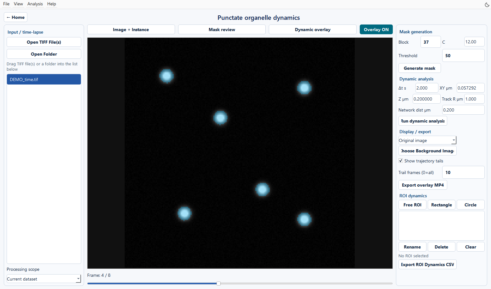

点状细胞器动态分析
==================

输入与目标
----------

从首页 **Punctate organelle dynamics** 进入。此模块面向点状细胞器时间序列，包含自动拆帧、阈值掩膜生成、掩膜查看、实例追踪、时间网络、ROI 统计和视频导出。

   图 14　合成时间序列的第 4/8 帧原图，用于练习时间序列操作。

1. 打开并拆分时间序列
------------------------

点击 **Open TIFF File(s)** 或 **Open Folder**，或直接拖入文件。选中数据集后，用主帧滑条浏览原始时间序列。点击 **Generate mask**，软件会自动拆分尚未准备的序列，在同名文件夹内生成 ``name_01.tif`` 等帧文件，再计算掩膜。

当前拆帧实现把 TYX 的第一轴作为时间；对于 TZYX，先对每个时间点进行 Z 最大投影。GUI 路线按二维时间帧处理，原始三维深度在投影后不保留。

使用中间的主查看区浏览原始序列、拆分帧、掩膜和追踪结果。拖动下方滑条切换时间帧。

**Processing scope** 决定处理 Current dataset 或 All loaded datasets。先用 Current dataset 验证一次完整流程。

2. 生成与修订掩膜
--------------------

在 MASK GENERATION 中设置 Block、C 和 Threshold，点击 **Generate mask**。切换 **Mask review**，在多个时间点检查前景连通性和背景噪声。更改阈值后再次生成，会覆盖对应帧的掩膜。

.. list-table:: 掩膜参数
   :header-rows: 1
   :widths: 25 18 57

   * - 参数
     - 默认值
     - 含义
   * - Block
     - 37
     - 自适应阈值的局部窗口，使用合适的奇数窗口
   * - C
     - 12
     - 局部自适应阈值偏移参数
   * - Threshold
     - 50
     - 增强图像转为二值掩膜的阈值，范围 0–255

掩膜叠加透明度固定为 35%。动态分析读取 ``processed_output/<frame>_mask.tif``，``viewer_mask_stack.tif`` 用于快速浏览。

.. note::

   **Mask review** 用于查看掩膜，该页面暂未提供添加/擦除笔刷。需要人工修订时，使用独立 TIFF 掩膜编辑工具，将最终二值掩膜保存回上述帧掩膜路径，保持名称与尺寸一致，并同步更新显示缓存。分析读取磁盘上的帧掩膜。重新点击 **Generate mask** 会覆盖人工修订版。

3. 设置物理尺度与追踪参数
----------------------------

.. list-table:: 动态分析参数
   :header-rows: 1
   :widths: 27 20 53

   * - GUI 字段
     - 默认值
     - 填写依据
   * - Δt s
     - 2.0
     - 相邻时间帧间隔，单位秒
   * - XY µm
     - 0.057292
     - X/Y 每个像素的物理大小
   * - Z µm
     - 0.20
     - Z 层间距
   * - Track R µm
     - 1.0
     - 追踪匹配的空间搜索半径
   * - Network dist µm
     - 0.20
     - 构建时间网络的表面距离阈值

填写显微镜实际标定；默认值只是软件初始设置。过小的 Track R 易产生轨迹断裂，过大的值会增加临近对象身份混淆。结合帧间位移与叠加轨迹调整。

4. 运行并检查动态分析
------------------------

点击 **Run dynamic analysis**。独立日志窗口依次报告掩膜转几何、实例分割、轨迹匹配、时间网络和查看缓存生成。日志永久保存为 ``processed_output/dynamic_analysis.log``。

完成后选择 **Dynamic overlay**，检查轨迹是否随同一对象连续移动。**Image + Instance** 显示图像和实例，**Mask review** 用于掩膜查看。使用 **Show trajectory tails** 与 Trail frames 控制尾迹长度；0 表示显示全部历史。

5. 选择背景与导出视频
------------------------

背景可选 Original image、Black、White、Gray。**Choose Background Image** 可加载已经配准的第二通道时间序列作为同步背景。选择 Overlay OFF 时只显示当前背景。背景替换属于显示操作，不能代替通道配准或改变用于定量的源数据。

点击 **Export overlay MP4**，导出 ``tif_instance_overlay_tracks.mp4``。视频播放速度与采集帧间隔是不同概念；时间定量使用 Δt。

6. ROI 动态统计
----------------------

1. 用 **Free ROI**、**Rectangle** 或 **Circle** 绘制区域。
2. 拖动/调整区域大小，通过 Rename 设置易识别且互不重复的名称。
3. 在几个时间点确认区域覆盖的目标位置。
4. 点击 **Export ROI Dynamics CSV**。

ROI 定义保存到 ``processed_output/roi_definitions.json``；结果保存到 ``processed_output/ROI_results/``。

``roi_dynamic_metrics.csv`` 每行对应一个 ROI 的一个时间点。对象计数使用 **实例质心位于 ROI 内部** 的规则；另提供与 ROI 相交的对象数量。ROI 为当前图像平面的区域，面积与投影形态指标按二维空间解读。首帧建立初始状态，进入/离开计数为 0；后续帧按 track_id 集合变化计算。

检查 ``organelle_count``、``roi_intensity_mean``、``mean_track_speed_um_per_s`` 等字段；追踪信息缺失时，相关指标可能为空。程序还生成数量与强度随时间变化的两张 PNG。
