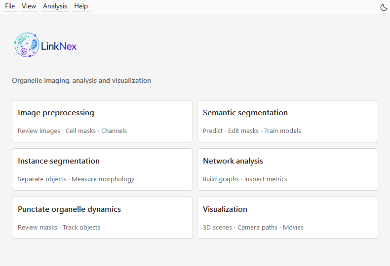

欢迎使用 LinkODT
========================

LinkODT 是用于分析显微图像中细胞器形态、空间组织和动态变化的图像分析流程。图形界面引导你依次完成图像预处理、分割、三维实例分析、网络分析和可视化。

你可以从原始 TIFF 开始，也可以使用已有掩膜、点云或网络结果继续分析。输出包括分割掩膜、三维几何文件、形态学与网络指标表，以及用于展示的图片和视频。具体文件及用途见 :doc:`outputs`。

本说明使用与 GUI 一致的英文按钮名称，并用“模块 1–6”对应首页的六个分析入口。

.. note::

   本手册说明 LinkODT 3.2。全部 GUI 截图已更新为当前界面；点击截图可查看原尺寸图像。

   图 1　LinkODT 首页。选择与当前输入数据对应的模块；Visualization 打开独立窗口。

分析流程
--------

**静态图像路线**：原始 TIFF → 质量控制 → 细胞掩膜与通道拆分 → 语义掩膜 → 三维物理/社会实例 → 层级网络 → 表格与三维展示。

**时间序列路线**：时间序列 TIFF → 自动拆帧 → 生成并检查掩膜 → 点状细胞器实例 → 持续轨迹与时间网络 → ROI 定量与叠加视频。掩膜检查与修订见 :doc:`dynamics`。

**结果展示路线**：已有 OBJ / TXT / CSV → Visualization Studio → 对象外观与相机设置 → PNG / MP4。

如何阅读本说明
--------------

首次使用请依次阅读 :doc:`setup-python`、:doc:`setup-linknex` 和 :doc:`new-users`。已有结果的用户可直接查阅 :doc:`advanced` 与 :doc:`outputs`。各模块教程按“准备输入—操作步骤—参数—检查结果—下一步”展开。

.. note::

   标为 ``DEMO`` 的文件为合成练习数据，其他主要示例使用真实 HeLa 图像及其局部结果。

.. toctree::
   :maxdepth: 2
   :caption: 使用说明

   setup-python
   setup-linknex
   new-users
   preprocessing
   semantic
   instance
   network
   dynamics
   visualization
   advanced
   workstation
   methods
   outputs
   requirements
   faq
   contributing
   sources
   citing
