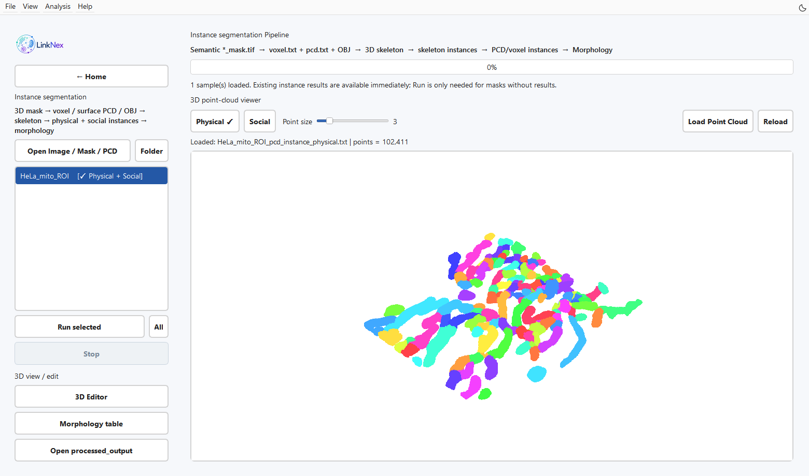
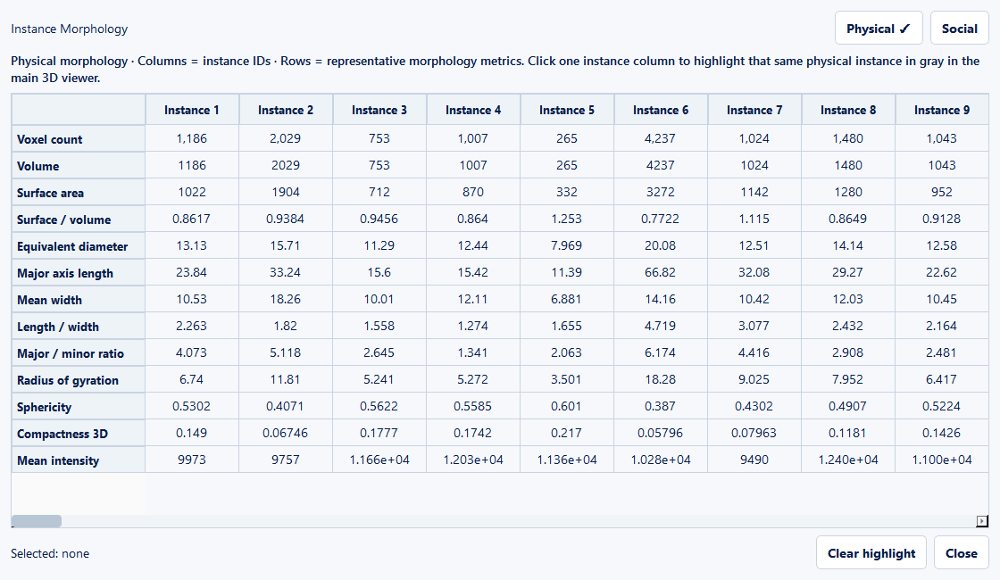
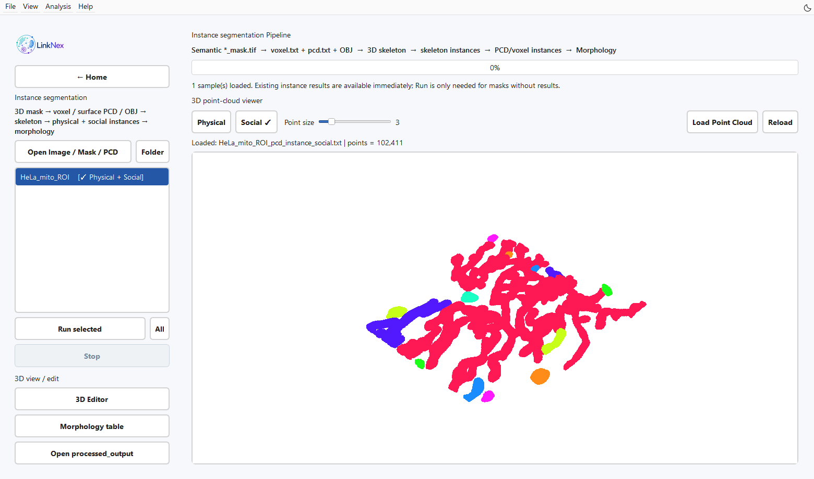

三维实例分割与形态学
====================

输入与目标
----------

从首页 **Instance segmentation** 进入。完整计算输入为 ``*_mask.tif`` / ``*_mask.tiff``，至少包含两层 Z，且前景非空。对应原图放在同目录，空间尺寸相同，便于保留强度信息。

   图 8　当前后端对 example 中的 HeLa 线粒体掩膜局部区域（256×256×42）计算得到的 Physical 实例。此处载入已有计算结果，Morphology table 打开定量表。

从掩膜计算
----------

1. 点击 **Open Image / Mask / PCD** 或 **Folder**，也可拖入图像、掩膜或点云。
2. 在左侧选中具有语义掩膜的样本，点击 **Run selected**；处理全部时使用 **Run all**。
3. 等待几何生成、骨架分析、实例映射和形态学计算。**Stop** 在计算检查点请求停止。
4. 切换 Physical / Social 结果，旋转、平移与缩放点云，观察细长分支、交叉处及小物体。
5. 点击 **Morphology table** 查看 Physical / Social 两类表。
6. 点击 **Open processed_output** 打开结果目录。

   图 9　真实 HeLa 局部数据的实际形态计算结果。本演示使用体素坐标，长度、面积与体积尚未按物理尺度校准；导出 CSV 保留完整字段。

算法输出的两种实例
------------------

**Physical** 对应骨架分支/边层级，用于描述物体内部结构。**Social** 对应连通物体层级，用于描述细胞内不同对象的空间组织。同一物体可以包含多个 Physical 分支。

颜色用于标识当前文件的标签。跨样本比较应使用表格中的标识和数据来源；颜色本身不提供跨样本身份。

   图 10　同一体数据的 Social 视图，每种颜色表示一个连通对象。与 Physical 对照，可区分完整对象和对象内部的分支。

直接加载已有结果
----------------

将原图、掩膜、TXT/PCD 或其文件夹拖入窗口。程序检查输入所在目录及其 ``processed_output/``，自动发现 ``*_pcd_instance_physical.txt`` 与 ``*_pcd_instance_social.txt``。选择结果即可查看，已有形态学 CSV 也会被识别。

仅有点云时可以浏览；重新运行完整实例分析仍需匹配的语义掩膜。搜索范围不包括任意深层子目录；遇到未识别结果时，直接打开其父目录或 ``processed_output``。

3D Editor
------------------

点击 **3D Editor** 打开独立点云实例编辑器。保留原始点云，另存修订文件，再重新加载检查标签和几何。需要更新形态学或网络统计时，先确认计算使用的实例数据已与修订点云同步。

形态学单位
----------

当前模块 3 调用形态学计算时将 ``voxel_size_xyz`` 固定为 ``(1,1,1)``。体积、表面积和长度应按体素坐标尺度解读；在模块 4 填写 XYZ scale 不会追溯改变已生成的形态学表。对于各向异性图像，物理单位形态学需在相应后端使用实际标定后重算。

检查结果
--------

检查前景边界、窄桥切分、独立小物体和点云颜色连续性。``*_instance_morphology_physical.csv`` 与 ``*_instance_morphology_social.csv`` 分别按对应实例给出体积、体素表面面积、形状和强度指标。接着使用 :doc:`network`。
