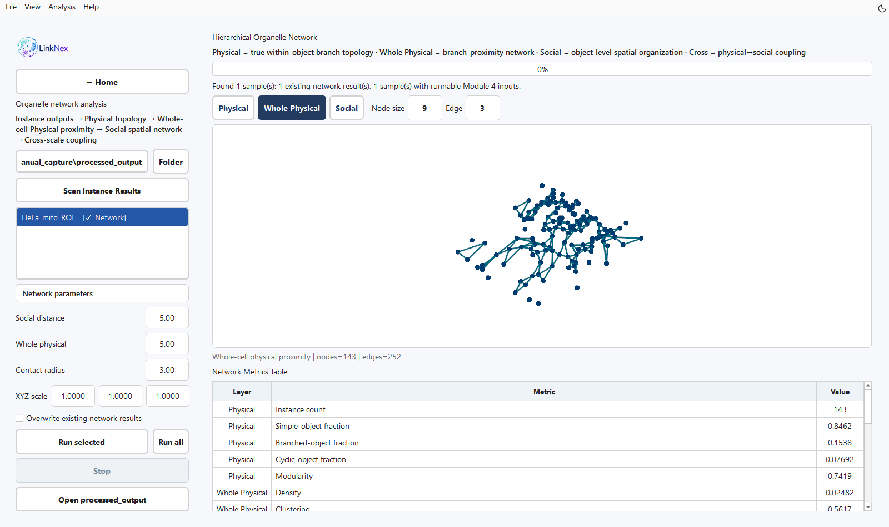
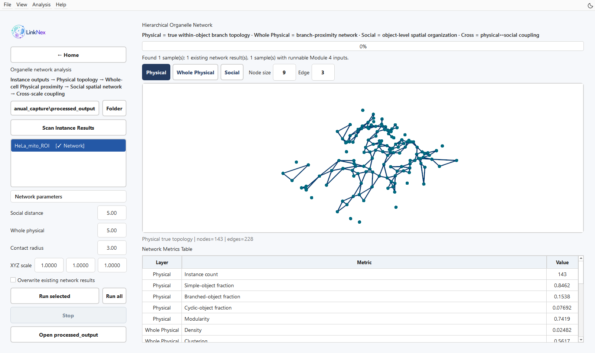
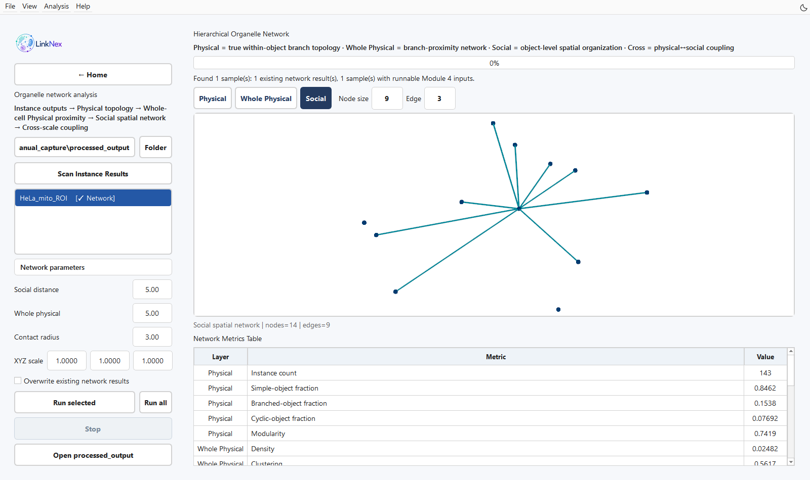

层级细胞器网络分析
==================

输入与目标
----------

从首页 **Network analysis** 进入。此模块使用实例输出构建物理拓扑、全细胞分支邻近网络、对象级空间网络及跨层联系，并给出图像/网络级指标。

   图 11　真实 HeLa 局部数据计算完成后的 Whole Physical 网络，包含 143 个节点与 252 条边。本流程演示使用体素坐标，距离参数为 5、5、3，XYZ scale 为 1、1、1。

操作步骤
--------

1. 在左侧 **Folder** 选择模块 3 的 ``processed_output``，点击 **Scan Instance Results**。也可拖入图像、掩膜、TXT/PCD、网络 PKL 或网络指标 CSV。
2. 选择样本。输入完整但尚无网络结果的样本标记为 Ready；已有结果可直接显示。
3. 输入 **XYZ scale**。原坐标以体素为单位时，将各轴真实尺寸填入相应字段。
4. 设置 **Social distance**、**Whole physical** 和 **Contact radius**。距离参数使用缩放后的同一坐标单位。
5. 点击 **Run selected** 或 **Run all**。重新计算已有网络时勾选 **Overwrite existing network results**。
6. 切换 Physical、Whole Physical、Social 三种图视图；跨层统计包含在指标和输出中。检查节点、边和下方 **Network Metrics Table**。用 Open processed_output 查看原始表和 PKL。

网络层级含义
------------

.. list-table:: 节点与边的定义
   :header-rows: 1
   :widths: 22 30 48

   * - 层级
     - 节点
     - 边或联系
   * - Physical
     - 骨架分支实例
     - 两个分支共享真实连接点
   * - Whole Physical
     - 骨架分支实例
     - 最小骨架点距离在阈值内，可跨对象
   * - Social
     - 连通细胞器对象
     - 两对象表面点云的最小距离在阈值内
   * - Cross
     - 分支与对象之间的映射
     - 层间归属、接近区域定位及耦合统计

Social 边表达由图像与距离阈值定义的空间邻近。生物接触或功能互作的判断需要结合成像分辨率与独立证据。

   图 12　Physical 按实际共享连接点连接分支。该局部区域的图中显示 143 个节点和 228 条边。

   图 13　Social 按距离阈值连接对象。此处阈值为 5 个体素坐标单位，查看区显示 14 个节点和 9 条边。节点位置概括对象位置，不表示对象轮廓。

参数说明
--------

.. list-table:: 界面默认参数
   :header-rows: 1
   :widths: 28 18 54

   * - 参数
     - 默认值
     - 调整方法
   * - Social distance
     - 5.0
     - 对象表面距离阈值；结合空间标定与研究问题设置
   * - Whole physical
     - 5.0
     - 骨架分支邻近阈值
   * - Contact radius
     - 3.0
     - 接近位置的局部区域判定半径
   * - XYZ scale
     - 1.0, 1.0, 1.0
     - 默认保留原始体素坐标；填入 µm/voxel 后距离使用 µm
   * - Overwrite existing network results
     - 未勾选
     - 保留并复用完整已有结果；修改参数后需重算才生效

例如原图 X/Y 为 0.10 µm、Z 为 0.30 µm，可填入 ``0.10, 0.10, 0.30``，此时 0.5 的距离阈值表示 0.5 µm。这里的数值仅展示填写方法，应替换为采集元数据。

结果检查
--------

确认所选样本名称、输出中的标定和阈值一致。调整阈值后比较边数和连通分量的变化，并检查对应空间位置。空白或 NaN 指标需结合网络规模与计算条件解释，不能自动记为零。

NumPy 兼容性问题的处理方法见 :doc:`faq`。

检查必需的实例文件
------------------------------------------------------------

计算网络前，确认同一 ``processed_output`` 目录中包含该样本的三个文件：``<name>_skeleton_edges.txt``、``<name>_skeleton_instance_social.txt`` 与 ``<name>_pcd_instance_social.txt``，文件名主干应一致。单独的点云可用于查看，但不足以提供全部网络输入。**Ready** 表示输入已备齐；运行后仍需检查最终日志与指标输出。

