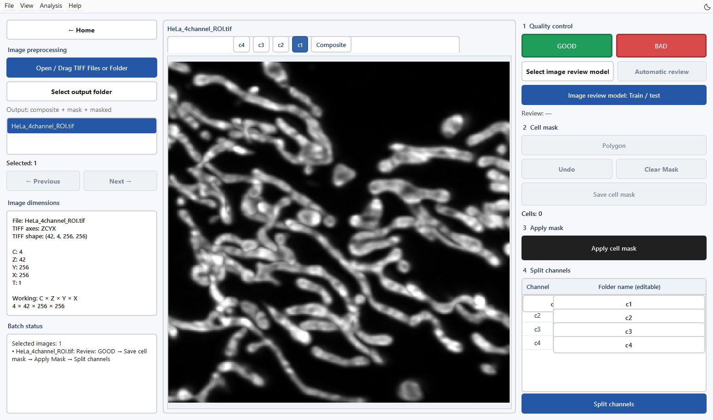
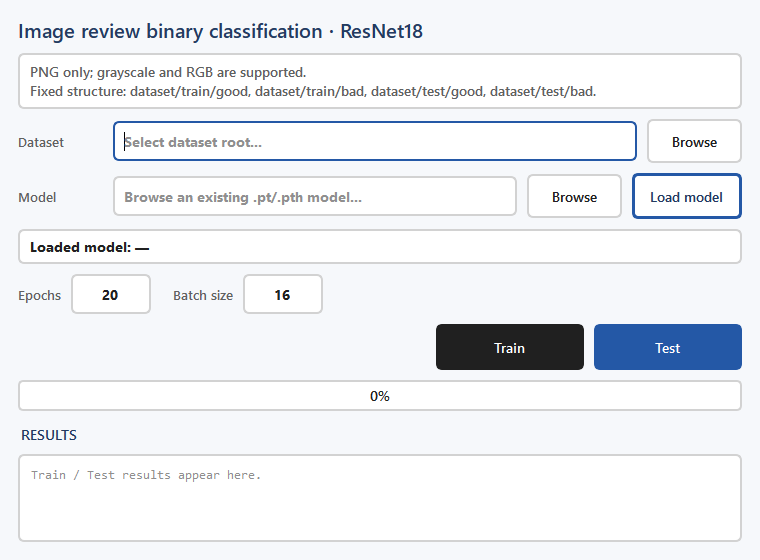

图像预处理与质量控制
====================

输入与目标
----------

从首页 **Image preprocessing** 进入。输入为 TIFF 图像或文件夹；输出为质量记录、Z 最大投影、细胞区域掩膜，以及按细胞和通道拆分的 TIFF。二维图像按 Z=1 处理。

   图 2　载入 example 中结构清晰的 HeLa 局部视野（256×256，42 层 Z，保留四通道），中央选择 c1 查看线粒体灰度最大投影。左侧显示输入与维度，右侧提供图像检查、细胞标注与通道拆分。

操作步骤
--------

1. 点击 **Open / Drag TIFF Files or Folder**，在弹窗中选择 Files 或 Folder。也可将 TIFF 或文件夹拖入窗口。
2. 查看左侧 **IMAGE DIMENSIONS**，核对 TIFF axes、shape、C、Z、Y、X。用中间的 **Composite** 和各通道按钮切换最大投影。
3. 点击 **Select output folder** 选择输出根目录；未指定时，软件根据输入路径组织输出。
4. 检查清晰度、信号和有效成像区域，点击 **GOOD**。软件允许通过后续细胞标注流程处理该图像。
5. 选择 **Polygon**，在投影上勾画细胞区域。每个细胞使用独立区域；检查右侧 Cells 数量，必要时用 **Undo** 回退。
6. 点击 **Save cell mask**，然后点击 **Apply cell mask**。软件将同一个二维细胞区域应用于所有 Z 层。
7. 在 **Folder name (editable)** 中填写各通道名称，再点击 **Split channels**。结果按细胞实例与通道分开保存。
8. 检查左侧 **BATCH STATUS** 的待办项，并打开结果目录确认输出。

.. important::

   **BAD** 会移动源 TIFF 到 ``QC_Bad/``，并处理该图像对应的已有预处理结果。它会改变磁盘文件。首次学习时请使用演示数据或输入副本。

批量与快捷键
------------

左侧列表支持多选；批量状态列出选中图像尚未完成的步骤。批量应用前逐张检查 GOOD 状态与细胞掩膜。``G`` 标记 GOOD，``B`` 标记 BAD，``Ctrl+Z`` 撤回最近的细胞掩膜编辑。

训练自动 图像检查 模型
------------------------

   图 3　图像检查模型的训练与测试配置窗口。

点击 **Image review model: Train / test**，按以下结构准备 PNG：

.. code-block:: text

   review_dataset/
     train/good/
     train/bad/
     test/good/
     test/bad/

支持灰度与 RGB PNG。选择数据根目录，填写 Epochs（默认 20）和 Batch size（默认 16），点击 **Train**。已有模型可用 Model → Browse → Load model 载入，再点击 Test。返回主界面后，用 Select image review model 选择模型，再使用 Automatic review。

检查与下一步
------------

确认投影中的细胞区域与原图对应，拆分结果的通道名称正确，Z 层数保持一致。二维细胞区域沿 Z 方向延伸，适用于按该区域提取堆栈；应检查上下层是否包含相邻细胞。之后进入 :doc:`semantic`。
