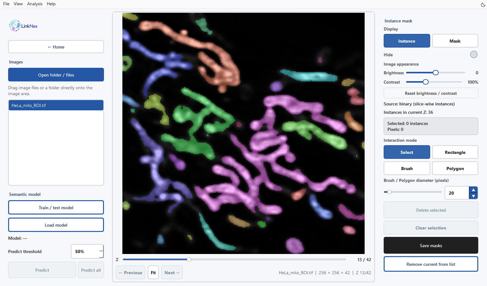
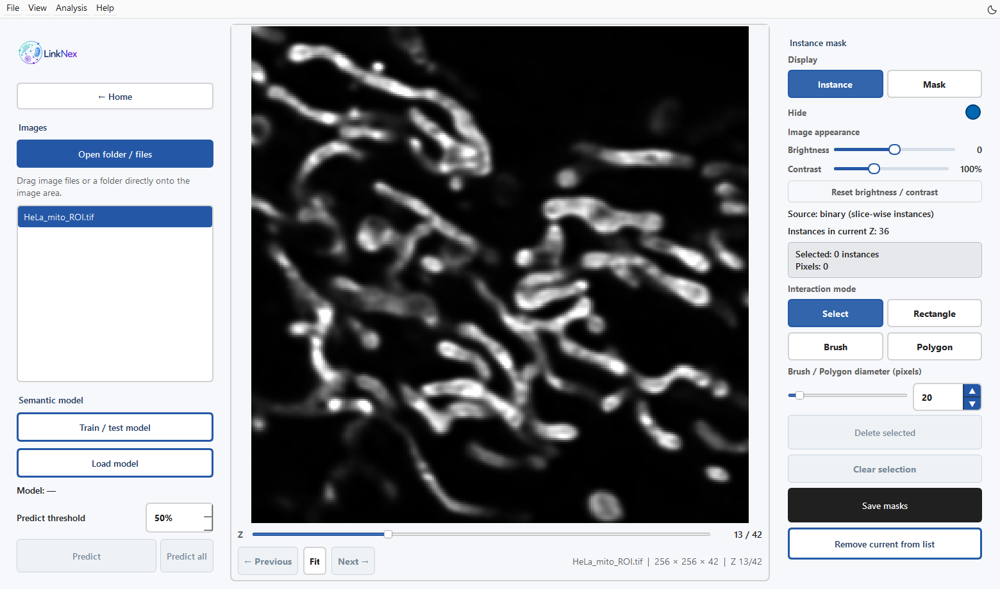
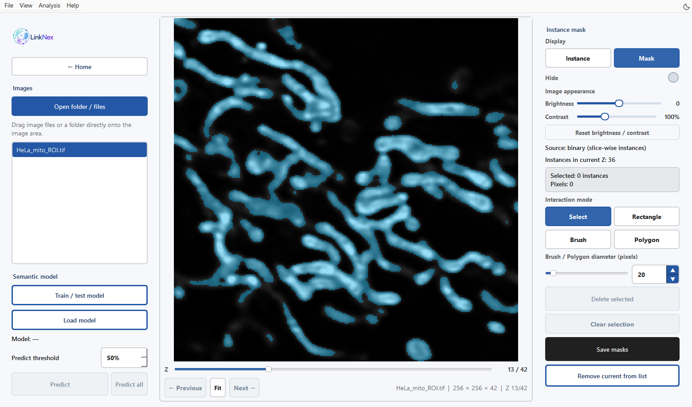
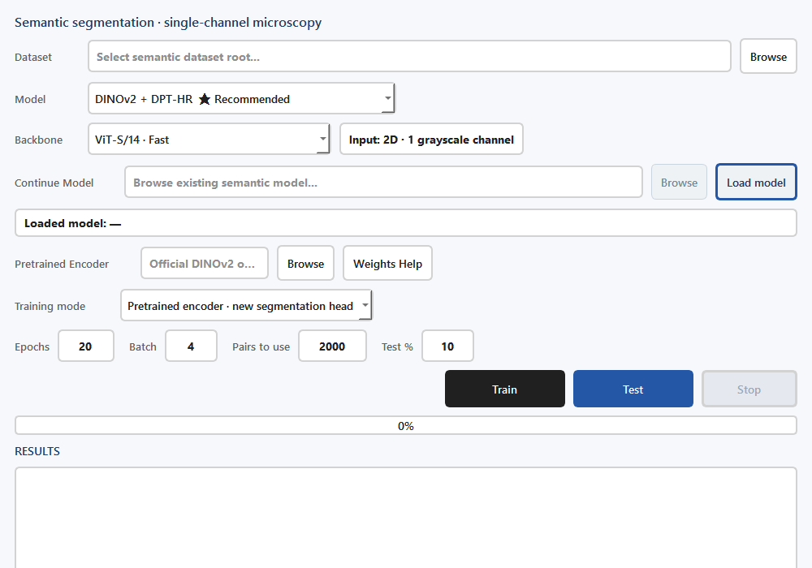

语义分割、训练与掩膜修订
========================

输入与目标
----------

从首页 **Semantic segmentation** 进入。此模块负责二维单灰度通道模型的训练，以及二维图像或三维堆栈逐层预测、掩膜修订与保存。

   图 4　256×256 HeLa 线粒体局部视野的第 13/42 层及已有掩膜，颜色区分当前切片内的前景连通区域。

载入与检查掩膜
--------------

1. 点击 **Open folder / files** 或拖入图像。程序按文件名查找同目录的二值掩膜与实例标签。
2. 拖动下方 **Z** 滑条检查不同切片。**Instance** 显示彩色标签，**Mask** 显示二值掩膜；**Hide** 控制叠加可见性。
3. 用 **Brightness** 与 **Contrast** 调整显示。它们只改变查看效果，不改写源 TIFF 与掩膜。
4. 用 Select 或 Rectangle 选择待删除标签；用 Brush 或 Polygon 补充缺失前景。具体操作见下表。
5. 删除误选前景时使用 **Delete selected**；**Clear selection** 只清除选择状态。
6. 点击 **Save masks**。保存会覆盖该图像对应的掩膜文件；继续分析时使用这份最新文件。

``Ctrl+S`` 保存，``Delete`` 删除已选标签，左右方向键切换图像。**Remove current from list** 将图像移出当前列表。

   图 5　打开 Hide，在相同切片和缩放下查看原图。修订前对照细小结构与间隙。

   图 6　Mask 将前景以青色叠加在同一原图上。切换 Hide，对照原始信号检查边界。示例载入随附掩膜。

掩膜编辑工具
------------------------------------------------------------

.. list-table:: 当前 Z 层的编辑操作
   :header-rows: 1

   * - 控件
     - 操作与结果
   * - Select
     - 左键点击标签；Ctrl 点击可切换其他标签的选中状态。
   * - Rectangle
     - 按住左键拖出矩形，选中矩形触及的标签；按住 Ctrl 可追加选择。
   * - Brush
     - 按住左键拖动，添加前景笔画。每笔生成一个新标签，已有前景受到保护。画成闭环也不会填充内部。
   * - Polygon
     - 按住左键连续描画轮廓，松开后闭合并填充区域；仅在背景像素上添加前景。
   * - Delete selected
     - 删除当前层中已选标签的完整区域，包括选择矩形外属于该标签的部分。
   * - Clear selection
     - 清除选择，不改变掩膜。
   * - 浏览
     - 右键拖动平移，鼠标滚轮缩放。

误分对象可选中后删除；缺失细结构用 Brush 补画；缺失整片区域用 Polygon 填充。保存前检查相邻 Z 层。保存会写出完整二值掩膜与实例标签堆栈，包含其他切片中的修改。

.. note::

   从二值掩膜载入时，右侧 Source 可显示 ``binary (slice-wise instances)``。此处彩色连通区域帮助逐层编辑；完整三维物理/社会实例分析在模块 3 中执行。

使用已有模型预测
----------------

1. 点击左侧 **Load model**，选择完整 LinkODT 语义分割 checkpoint。
2. 查看 Model 状态，确认加载成功。
3. 设置 **Predict threshold**（默认 50%），点击 **Predict** 处理当前图像。
4. 检查多个 Z 层，修订明显误分后保存。确认单例效果后，再使用 **Predict all** 对所有已载入图像预测。

**All 会覆盖已有预测掩膜输出。** 如果需要保留人工修订版，请先另存该版本，再批量预测。

训练与测试
----------

   图 7　当前语义模型训练／测试配置窗口。架构、骨干网络与权重类型需要对应；此图仅展示配置，不表示已执行训练。

1. 点击 **Train / test model**，在 Dataset 中选择包含 ``image/`` 和 ``mask/`` 的目录。
2. 在 **Model** 中选择架构，在 **Backbone** 中选择骨干。
3. 首次训练选择 **Pretrained encoder · new segmentation head**。初始化取决于 Model：DINOv2 架构需匹配的编码器权重；U-Net 无需预训练编码器；SegFormer-B2 使用本地预训练模型目录。
4. 继续已有分割模型时选择 **Continue existing LinkODT model**，通过 Continue Model 载入完整模型。
5. 设置 Epochs、Batch、Pairs to use 和 Test %，点击 **Train**。检查 RESULTS 中的配对检查、划分信息与训练进度。
6. 训练后点击 **Test**，检查测试表、Dice 等指标和图像预览。**Stop** 用于停止当前训练任务。

.. list-table:: GUI 中的主要训练参数
   :header-rows: 1
   :widths: 24 20 56

   * - 参数
     - 当前默认值
     - 使用说明
   * - Model
     - DINOv2 + DPT-HR
     - DPT 解码器配合高分辨率局部 CNN 分支
   * - Backbone
     - ViT-S/14
     - 与预训练编码器保持一致；ViT-B/14 为可选更大骨干
   * - Epochs
     - 20
     - 训练轮数；结合损失曲线与预览检查收敛
   * - Batch
     - 4
     - 显存不足时先减小批量
   * - Pairs to use
     - 2000
     - 从有效图像/掩膜配对中选取；数量超过有效配对时使用全部
   * - Test %
     - 10
     - 自动划分比例；实际划分写入 manifest

模型选择
--------

界面包含 U-Net、DINOv2 + U-Net、DINOv2 + DPT、DINOv2 + DPT-HR、DINOv2 + UPerNet、DINOv2 + QueryMask 和 SegFormer-B2。QueryMask 使用可移植的 PyTorch 查询式解码器，其界面名称注明 Mask2Former-style。SegFormer-B2 使用可选 transformers 依赖。

DINOv2 提供 ViT-S/14、ViT-B/14 及两者的 registers 版本。选择与编码器权重对应的 Backbone；GUI 的默认值为 ViT-S/14。

训练数据与输出检查
------------------

程序会写出 ``Semantic_dataset_dimension_check.csv``、``Semantic_skipped_bad_pairs.csv``、``Semantic_split_manifest.csv``。训练预览在每轮对固定测试子集进行预测；开发过程中据此选择模型时，另留独立最终测试集，按原始样本或实验批次隔离相邻切片。

完整模型保存到项目 ``models/`` 下的时间戳文件；训练曲线与 ``Semantic_training_metrics.csv`` 帮助追踪过程。测试输出包含 ``Semantic_test_results.csv``。具体位置以 RESULTS 日志打印的路径为准。

保存掩膜后进入 :doc:`instance`。

选择正确的权重
------------------------------------------------------------

.. list-table:: 权重文件及其用途
   :header-rows: 1

   * - 任务／架构
     - 所需输入
   * - Predict
     - 包含分割头的完整 LinkODT 分割 checkpoint。
   * - 首次训练 DINOv2 架构
     - 与 Backbone 匹配的官方 DINOv2 或项目 SSL 编码器权重。
   * - 首次训练 U-Net
     - 无需预训练编码器；编码器权重控件处于禁用状态。
   * - 首次训练 SegFormer-B2
     - 可选 transformers 依赖，以及本地 ``models/hf_segformer_b2_ade`` 文件。
   * - Continue existing LinkODT model
     - 完整 LinkODT checkpoint；架构和骨干从 checkpoint 恢复。

单独的编码器初始化权重无法用于 Predict。默认预测阈值为 50%，概率超过阈值的像素成为前景。降低阈值会纳入更多前景，提高阈值会减少前景。选择阈值时检查边界、小对象和多个 Z 层。

保存与离开图像
------------------------------------------------------------

切换图像或关闭应用时若掩膜尚未保存，可选择 **Save**、**Discard** 或 **Cancel**。Save 先保存再继续；Cancel 保持当前图像。保存失败时，应用保留未保存状态。
