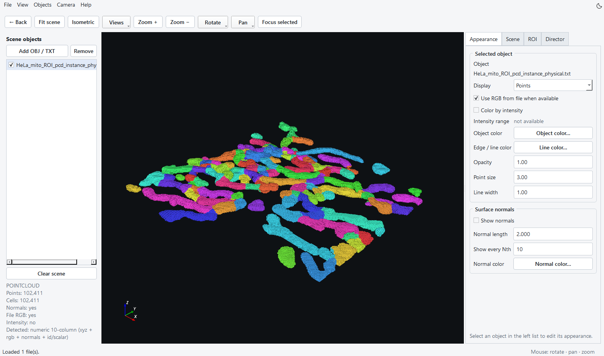
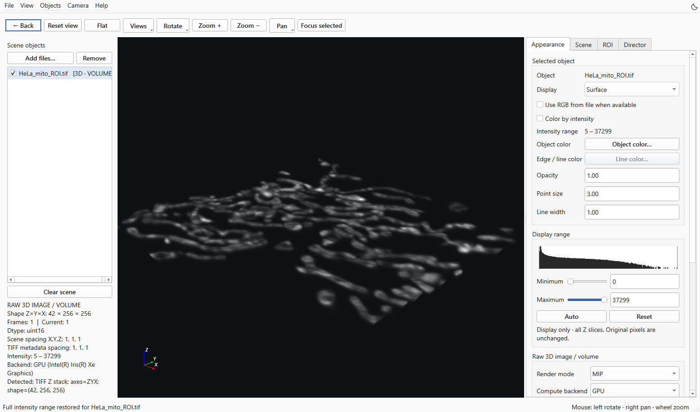
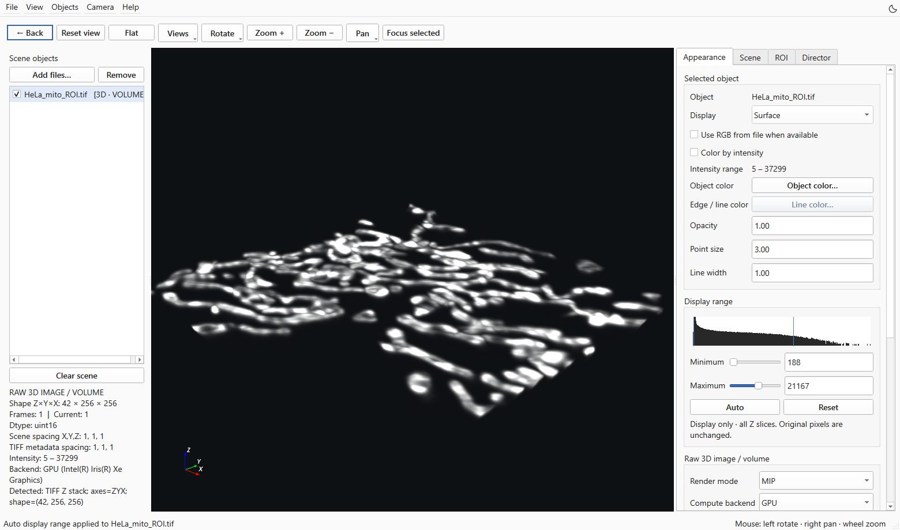
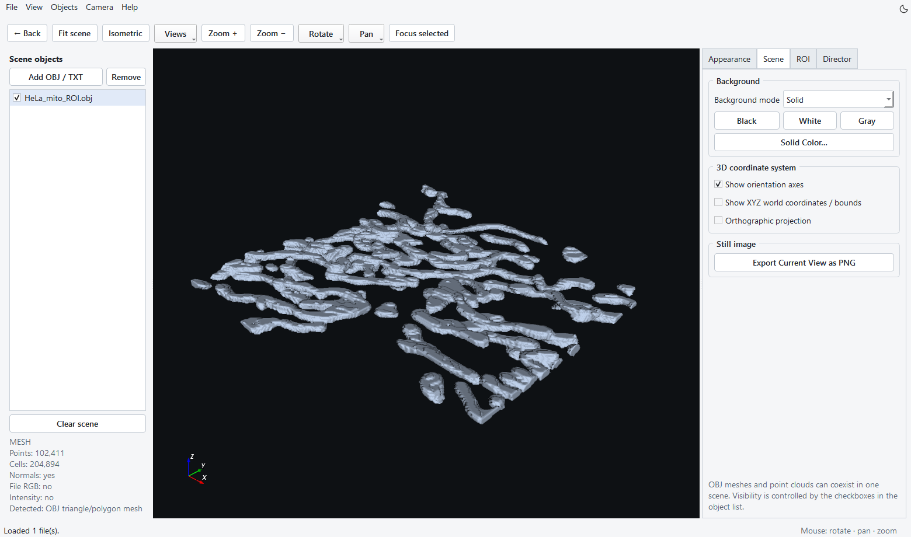
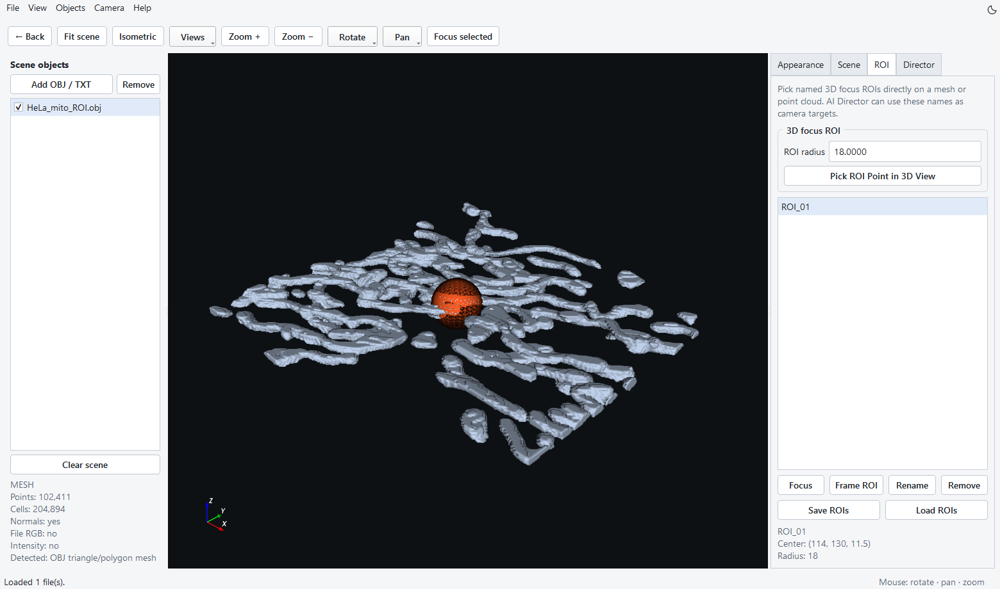
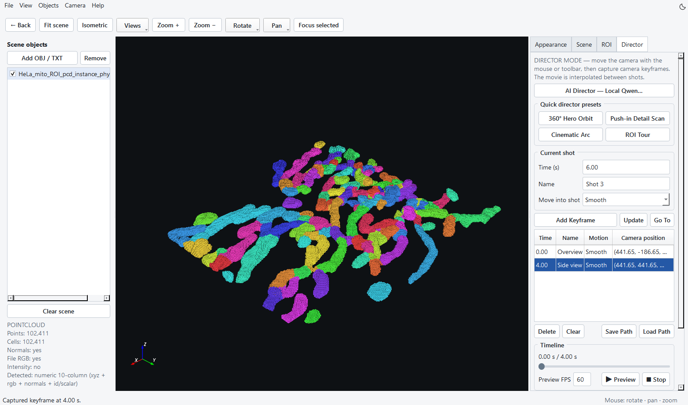

Visualization Studio
========================================

启动与输入
----------

首页点击 **Visualization**，打开独立应用。

返回主程序时，点击工具栏左侧 **← Back**、按 ``Ctrl+W``，或关闭 Visualization Studio 窗口。该窗口独立运行，主程序保持打开；如被其他窗口遮挡，可用 ``Alt+Tab`` 切回 LinkODT。关闭前请先导出需要保留的场景图像与相机路径。

也可从项目根目录运行：

.. code-block:: powershell

   python visualization/main.py

输入支持 TIFF 图像、三维 TIFF 堆栈、TIFF 时间序列、OBJ 网格和 TXT/CSV 点云。TIFF 的各通道作为独立场景对象载入。带表头的点云应明确 ``x,y,z``；可选 ``r,g,b``、``nx,ny,nz``、强度和标签列。无表头点云按列布局推断，载入后务必检查颜色与法向是否符合预期。

菜单与界面主题
----------------------------------------------------------------------

通过 **File** 载入对象、导出图像／视频、读取或保存相机路径；**View** 提供视角、面板显示和主题设置；**Objects** 管理场景列表；**Camera** 提供旋转、平移、对焦和关键帧操作；**Help** 打开手册与团队信息。

精简工具栏保留 Reset view、Flat、Zoom 与 Focus selected；**Views**、**Rotate** 和 **Pan** 用下拉菜单提供其他操作。通过 **View → Fit scene** 将所有可见对象纳入视野。窗口较矮时，右侧控件可以滚动查看。

点击右上角的太阳／月亮图标按钮、使用 **View → Theme**，或按 ``Ctrl+Shift+T`` 切换界面深浅颜色。偏好会保存，并由主程序和 Visualization Studio 共用。界面主题不修改对象颜色、场景背景和导出图像颜色；渲染背景在 Scene 中设置。

   图 15　真实 HeLa 局部数据生成的 Physical 实例点云，使用文件 RGB 颜色显示。当前界面包含返回按钮、分组相机菜单与主题切换。

对象与外观
----------

1. 点击 **Add files…** 或拖入文件。可同时载入多个对象。
2. 在 Scene objects 中勾选对象可见性，选中对象后调整右侧属性。
3. 选择 Surface、Surface + Edges、Wireframe 或 Points；调整 Point size、Line width、Opacity。
4. 使用文件 RGB 显示实例颜色，或通过 Object color… 指定单色。
5. 对 XYZ + Intensity 点云，强度映射到颜色亮度；当前最低亮度参数为 0.35。检查 Intensity range，避免将展示颜色当作原始强度单位。
6. 根据需要显示法向、坐标轴和世界坐标网格。

TIFF 亮度与对比度
--------------------

在 **Scene objects** 中选择一个 TIFF 通道，打开 **Appearance → Display range**。这些控件适用于 **MIP** 和 **Volume** 两种渲染方式。直方图显示该通道的强度分布，柱高使用对数尺度，便于观察数量较少的强度值；蓝色标记表示当前显示范围的上下限。

* **Auto** 根据强度分布选择显示范围。LinkODT 使用第 0.175 和第 99.825 百分位数，最多从均匀抽取的一百万个值估计，将少量极暗和极亮的值留在范围之外。同一份数据反复点击 Auto，得到的范围相同。
* **Reset** 恢复完整的有限强度范围，同时将 Brightness 设为 0、Contrast 设为 1、Background cutoff 设为 0。对象颜色、透明度、相机、空间标定与渲染方式保留当前设置。
* **Minimum / Maximum** 可通过滑块调整，也可直接输入原始强度值。低于或等于 Minimum 的值显示为暗色，高于或等于 Maximum 的值达到所选颜色的最亮端。缩窄范围可以增强可见对比度。修改任一上下限时，相对亮度、对比度和背景截断控件会复位，以直接使用输入的显示范围。

先点击 **Reset** 查看完整范围，再点击 **Auto** 观察较暗的结构，需要时继续调整 Minimum 或 Maximum。原有的 **Brightness**、**Contrast** 和 **Background cutoff** 仍可进一步调整显示；上下限控件会随亮度、对比度变化同步更新。

各通道的设置独立保留。对于时间序列，Auto 和 Reset 使用该通道所有时间点的数据，并在播放时保持同一显示范围，便于比较各帧。强度完全相同的数据使用一个很小的正显示宽度；非有限值不参与范围估计。

这些操作只改变显示映射，不修改 TIFF 像素，不生成二值掩膜，也不改变分割和测量结果。导出的 PNG 与视频记录当前显示效果；生成或修改掩膜请使用分割模块。

   Reset：真实 HeLa 线粒体局部数据的完整强度范围。Appearance 中可查看直方图与显示上下限，原始图像保持不变。

   Auto：保持同一数据、相机、颜色和渲染方式，自动选择显示窗口。可与 Reset 对照观察较暗结构的显示变化。

场景与 PNG
--------------

Scene 中可选择纯色或渐变背景，设置 Black、White、Gray 或自定义颜色。使用 Fit scene、Isometric 与 Views 下拉菜单建立视角，选择透视或正交投影。点击 **Export Current View as PNG** 导出当前场景。

   图 16　同一 HeLa 局部区域的 OBJ 表面网格显示前景几何。Scene 包含背景、投影、坐标轴和 PNG 导出控件。网格用于观察表面，彩色 TXT 视图用于查看实例标签。

三维 ROI 与焦点
--------------------

在 ROI 页设置名称与半径，点击 **Pick ROI Point in 3D View** 后在对象上选点。使用 Focus / Frame ROI 将相机对准目标。ROI 可保存为 JSON 并再次载入。此处 ROI 用于三维对焦和镜头组织；时间序列的定量 ROI 在模块 5 中设置。

   图 17　ROI_01 以表面上的一点为中心，半径为 18 个体素坐标单位。选中该 ROI 后可使用 Focus 或 Frame ROI。线框球帮助设置相机视野，不改变分割或测量结果。

Director 相机动画
--------------------------

   图 18　围绕 HeLa 点云设置了 0 s 和 4 s 两个相机关键帧。Director 提供预览、路径保存与 MP4 导出。

1. 用鼠标或相机工具栏摆好起始视角。
2. 设置时间为 0 s，点击 **Add Keyframe**。
3. 移动相机到下一视角，设置更晚时间，再添加关键帧。
4. 选择进入该镜头的插值方式，如 Smooth、Orbit、Linear 或 Hold。
5. 点击 Preview 检查完整时间线，必要时调整关键帧。
6. 保存相机路径 JSON，填写输出 FPS 与渲染分辨率比例（1×–4×），导出 MP4。

360° Hero Orbit、Push-in Detail Scan、Cinematic Arc、ROI Tour 提供快速镜头预设。大角度旋转拆成多个中间关键帧；当前 Orbit 使用恒定角速度。ROI 辅助球在预览与视频导出期间自动隐藏。

AI Director（可选）
------------------------------

安装本地推理依赖并准备 GGUF 文件后，打开 AI Director，选择本地模型并输入镜头描述，例如“围绕整体旋转一圈，再拉近到 ROI_1”。先检查生成的动作计划，再应用到时间线并预览。模型仅用于生成受限的相机动作计划；常规手动关键帧流程可独立使用。

