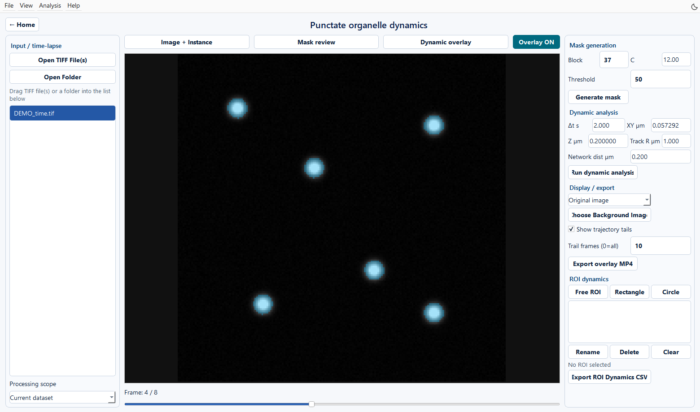

Punctate organelle dynamics
======================================================

Inputs and purpose
------------------------------------

Open **Punctate organelle dynamics** from Home. The module handles time series of punctate organelles, including automatic frame preparation, threshold masks, mask inspection, instance tracking, temporal networks, ROI measurements, and video export.

   Figure 14. Original frame 4/8 of the synthetic time series. This sequence is provided for practising time-series operations.

1. Open and prepare a time series
------------------------------------------------------------------

Click **Open TIFF File(s)** or **Open Folder**, or drag in files. Select a dataset and browse the original frames with the main slider. Click **Generate mask** to prepare unprocessed sequences automatically, write ``name_01.tif`` and subsequent frames into a same-stem folder, and calculate masks.

For TYX input, the first axis is treated as time. For TZYX input, the current implementation makes a Z maximum projection for each time point. The GUI route processes two-dimensional time frames, so projection removes the original depth information.

Use the central viewer to inspect the original sequence, prepared frames, masks, and tracking overlays. Move the slider below it to select a time frame.

**Processing scope** selects Current dataset or All loaded datasets. Verify one complete workflow with Current dataset first.

2. Generate and revise masks
--------------------------------------------------------

Set Block, C, and Threshold under MASK GENERATION and click **Generate mask**. Switch to **Mask review** and inspect foreground connectivity and background noise at several time points. Regeneration after threshold changes overwrites the corresponding frame masks.

.. list-table:: Mask settings
   :header-rows: 1
   :widths: 25 18 57

   * - Parameter
     - Default
     - Meaning
   * - Block
     - 37
     - Local adaptive-threshold window; use an appropriate odd size
   * - C
     - 12
     - Offset in local adaptive thresholding
   * - Threshold
     - 50
     - Threshold for binarizing the enhanced image, in the range 0–255

Mask overlay opacity is fixed at 35%. Dynamic analysis reads ``processed_output/<frame>_mask.tif``; ``viewer_mask_stack.tif`` supports fast display.

.. note::

   **Mask review** displays masks; add/erase brush controls are not available on this page. For manual revisions, use a separate TIFF-mask editor and save final binary masks to the frame-mask paths above, preserving filenames and dimensions. Update the display cache to match. Analysis reads frame masks from disk. Clicking **Generate mask** again overwrites manual revisions.

3. Set calibration and tracking parameters
------------------------------------------------------------------------------------

.. list-table:: Dynamic analysis settings
   :header-rows: 1
   :widths: 27 20 53

   * - GUI field
     - Default
     - What to enter
   * - Δt s
     - 2.0
     - Interval between consecutive frames, in seconds
   * - XY µm
     - 0.057292
     - Physical pixel size in X/Y
   * - Z µm
     - 0.20
     - Z spacing
   * - Track R µm
     - 1.0
     - Spatial search radius for tracking
   * - Network dist µm
     - 0.20
     - Surface-distance threshold for temporal networks

Enter the microscope calibration. Defaults are initial software settings. A small Track R can fragment tracks; a large value can increase identity ambiguity among nearby objects. Inspect frame-to-frame motion and overlays when adjusting it.

4. Run and inspect dynamic analysis
----------------------------------------------------------------------

Click **Run dynamic analysis**. A separate log window reports mask-to-geometry conversion, instance segmentation, matching, temporal networks, and viewer-cache generation. The permanent log is ``processed_output/dynamic_analysis.log``.

After completion, select **Dynamic overlay** and check that each track follows the same object. **Image + Instance** displays images and instances; **Mask review** displays masks. **Show trajectory tails** and Trail frames control tail length; 0 displays the full history.

5. Select a background and export video
------------------------------------------------------------------------------

Background options are Original image, Black, White, and Gray. **Choose Background Image** loads an already registered second-channel time series as a synchronized background. Overlay OFF displays the background alone. Background replacement affects display; it does not perform channel registration or change the quantitative source input.

Click **Export overlay MP4** to create ``tif_instance_overlay_tracks.mp4``. Video playback rate and acquisition interval are separate settings. Time-dependent measurements use Δt.

6. ROI dynamics
------------------------------

1. Draw regions with **Free ROI**, **Rectangle**, or **Circle**.
2. Move/resize regions and use Rename to assign clear, unique names.
3. Check coverage at several time points.
4. Click **Export ROI Dynamics CSV**.

ROI definitions are saved to ``processed_output/roi_definitions.json``; outputs are saved under ``processed_output/ROI_results/``.

Each row of ``roi_dynamic_metrics.csv`` represents one ROI at one time point. Object counts use **instance centroids inside the ROI**; counts of objects intersecting the ROI are also provided. ROIs lie in the current image plane, and areas/projected morphology are two-dimensional measurements. The first frame establishes the initial state with entry/exit counts set to 0. Subsequent counts use changes in track_id sets.

Inspect fields such as ``organelle_count``, ``roi_intensity_mean``, and ``mean_track_speed_um_per_s``. Tracking-dependent fields may be empty when tracking information is unavailable. Export also generates two PNG plots of count and intensity over time.
