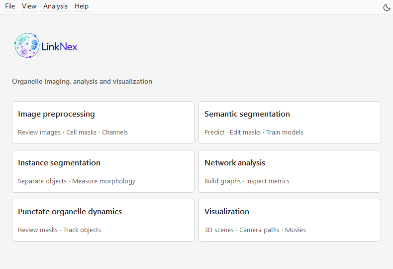

Welcome to LinkODT
====================================

LinkODT is an image-analysis pipeline for measuring organelle morphology, spatial organization, and dynamics from microscopy images. The graphical interface guides you through image preprocessing, segmentation, three-dimensional instance analysis, network analysis, and visualization.

You can start with raw TIFF images or use existing masks, point clouds, and network results. Outputs include segmentation masks, three-dimensional geometry, morphology and network tables, and images and videos for presentation. See :doc:`outputs` for filenames and their uses.

Button names in this guide match the GUI. Modules 1–6 refer to the six analysis options on the home screen.

.. note::

   This guide describes LinkODT 3.2. All GUI screenshots show the current interface. Click a screenshot to open its full-resolution image.

   Figure 1. LinkODT home screen. Choose a module that matches your input. Visualization opens in a separate window.

Analysis workflows
------------------------------------

**Static images:** raw TIFF → quality control → cell masks and channel splitting → semantic masks → three-dimensional Physical/Social instances → hierarchical networks → tables and three-dimensional presentation.

**Time series:** time-lapse TIFF → automatic frame preparation → mask generation and inspection → punctate organelle instances → persistent tracks and temporal networks → ROI measurements and overlay videos. See :doc:`dynamics` for mask inspection and revision.

**Presentation:** existing OBJ / TXT / CSV → Visualization Studio → object appearance and camera settings → PNG / MP4.

How to use this guide
------------------------------------------

First-time users should read :doc:`setup-python`, :doc:`setup-linknex`, and :doc:`new-users` in order. Users with existing results can go directly to :doc:`advanced` and :doc:`outputs`. Module tutorials explain input preparation, operations, parameters, result checks, and the next step.

.. note::

   Files marked ``DEMO`` are synthetic practice data. Most other examples use real HeLa images and cropped results.

.. toctree::
   :maxdepth: 2
   :caption: User guide

   setup-python
   setup-linknex
   new-users
   preprocessing
   semantic
   instance
   network
   dynamics
   visualization
   advanced
   workstation
   methods
   outputs
   requirements
   faq
   contributing
   sources
   citing
