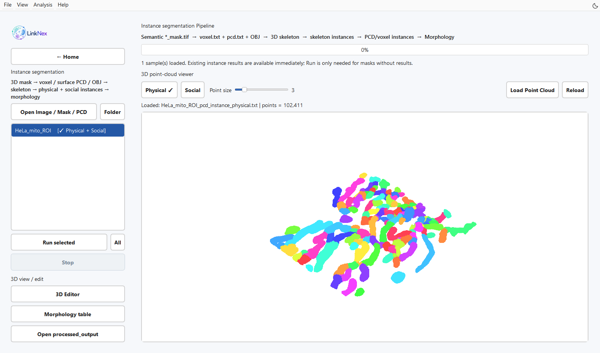
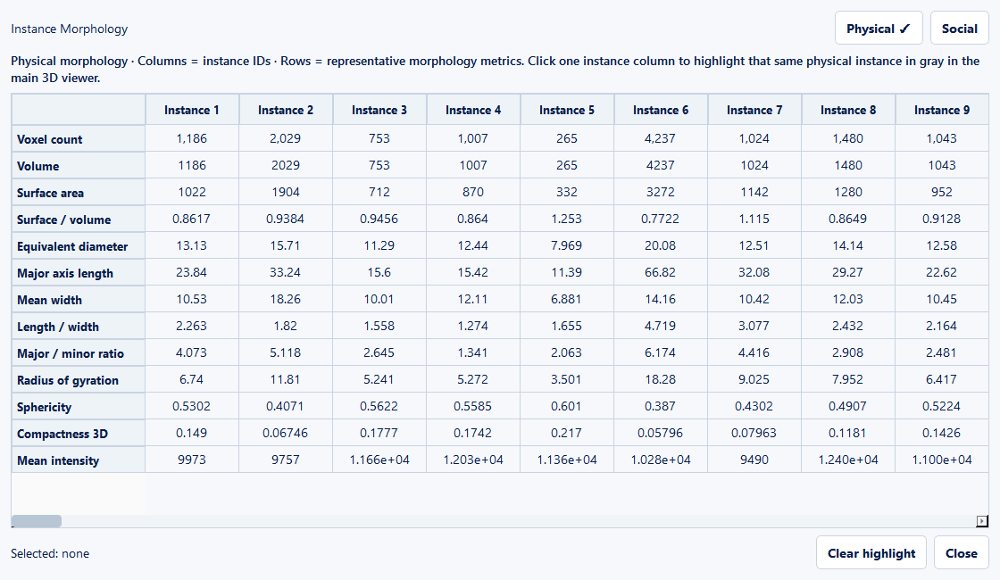
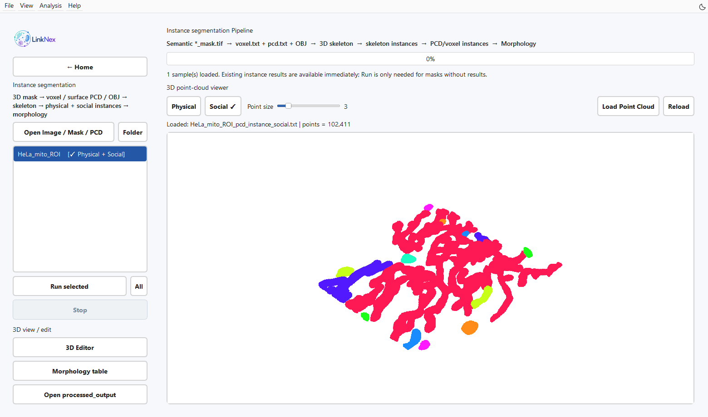

Three-dimensional instances and morphology
====================================================================================

Inputs and purpose
------------------------------------

Open **Instance segmentation** from Home. The full pipeline takes ``*_mask.tif`` / ``*_mask.tiff`` with at least two Z slices and nonempty foreground. Keep the matching original image in the same directory, with identical spatial dimensions, to retain intensity information.

   Figure 8. Physical instances calculated by the current backend from a 256×256×42 crop of the supplied HeLa mitochondrial mask. Existing results are loaded for inspection; Morphology table opens the measurements.

Compute from a mask
--------------------------------------

1. Click **Open Image / Mask / PCD** or **Folder**, or drag in images, masks, or point clouds.
2. Select a sample with a semantic mask and click **Run selected**. Use **Run all** for all loaded samples.
3. Wait for geometry generation, skeleton analysis, instance mapping, and morphology calculation. **Stop** requests termination at computation checkpoints.
4. Switch between Physical / Social results. Rotate, pan, and zoom to inspect thin branches, crossings, and small objects.
5. Click **Morphology table** to inspect the two sets of measurements.
6. Click **Open processed_output** to open the output directory.

   Figure 9. Actual morphology measurements for the real HeLa crop. This demonstration uses voxel coordinates; lengths, areas and volumes are not calibrated physical measurements. Exported CSVs retain all fields.

Two instance definitions
------------------------------------------------

**Physical** corresponds to skeleton branches/edges and describes internal structure. **Social** corresponds to connected objects and describes spatial organization among objects in a cell. One object may contain several Physical branches.

Colors identify labels in the current file. Use table identifiers and data provenance for comparisons across samples; display colors do not establish identity across samples.

   Figure 10. The same volume in Social mode: one colour per connected object. Compare this view with Physical to distinguish whole objects from their internal branches.

Load existing results directly
------------------------------------------------------------

Drag an original image, mask, TXT/PCD, or folder into the window. The application checks the input directory and its ``processed_output/`` folder for ``*_pcd_instance_physical.txt`` and ``*_pcd_instance_social.txt``. Select a result to display it. Existing morphology CSVs are also recognized.

Point clouds alone support inspection. Rerunning the full instance analysis requires the matching semantic mask. Discovery covers the expected directories; for results in deeper folders, directly open their parent or ``processed_output``.

3D Editor
------------------

Click **3D Editor** to open the independent point-cloud instance editor. Keep the original point cloud, save revisions separately, and reload them to check labels and geometry. Before recalculating morphology or network measurements, confirm that the instance data used for calculation matches the revised point cloud.

Morphology units
--------------------------------

Module 3 currently calls morphology calculations with ``voxel_size_xyz`` fixed to ``(1,1,1)``. Interpret volumes, surface areas, and lengths in voxel-coordinate units. XYZ scale in module 4 does not retroactively change existing morphology tables. For anisotropic images, recalculate morphology with the actual spatial calibration in the relevant backend to obtain physical units.

Check results
--------------------------

Inspect foreground boundaries, narrow-bridge separation, small independent objects, and point-cloud label continuity. ``*_instance_morphology_physical.csv`` and ``*_instance_morphology_social.csv`` provide volume, voxel-surface area, shape, and intensity measurements for their respective instance definitions. Continue to :doc:`network`.
