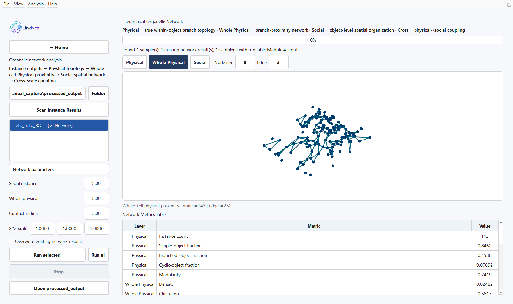
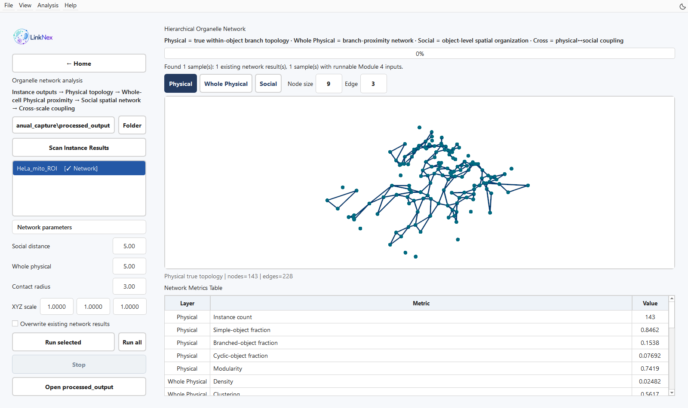
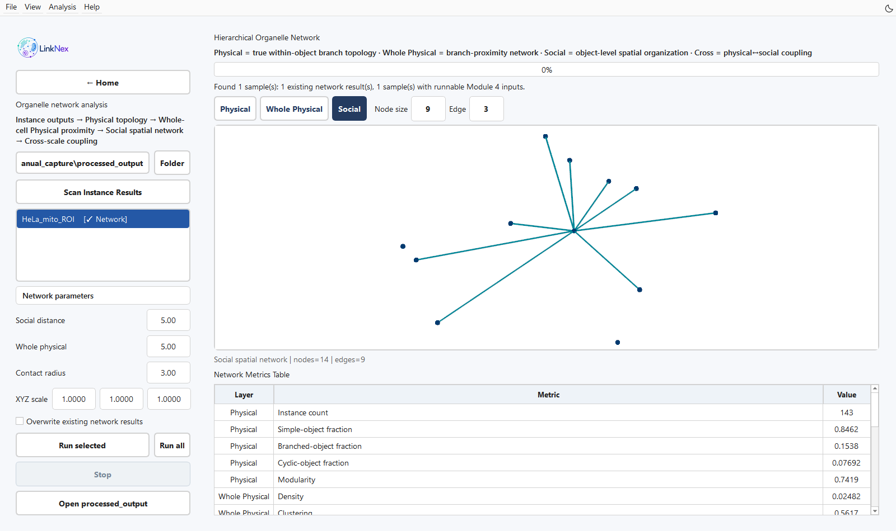

Hierarchical organelle network analysis
==============================================================================

Inputs and purpose
------------------------------------

Open **Network analysis** from Home. The module uses instance outputs to construct physical topology, cell-wide branch proximity, object-level spatial networks, and cross-layer relationships, then reports image/network-level metrics.

   Figure 11. Completed Whole Physical network results for the real HeLa crop: 143 nodes and 252 edges. The displayed distance thresholds (5, 5 and 3) and XYZ scale (1, 1, 1) use voxel coordinates for this workflow demonstration.

Procedure
------------------

1. Use **Folder** to select module 3's ``processed_output`` and click **Scan Instance Results**. Images, masks, TXT/PCD, network PKL, and metric CSV files can also be dragged into the window.
2. Select a sample. Samples with complete inputs and no network outputs are marked Ready; existing results can be displayed directly.
3. Enter **XYZ scale**. For voxel coordinates, enter the actual size of each axis.
4. Set **Social distance**, **Whole physical**, and **Contact radius** using the same units as the scaled coordinates.
5. Click **Run selected** or **Run all**. Select **Overwrite existing network results** to recompute an existing result.
6. Switch between Physical, Whole Physical, and Social graph views. Cross-layer statistics are included in the metrics and outputs. Inspect nodes, edges, and **Network Metrics Table**. Use Open processed_output to inspect CSV and PKL files.

Network definitions
--------------------------------------

.. list-table:: Nodes and relationships
   :header-rows: 1
   :widths: 22 30 48

   * - Layer
     - Nodes
     - Edges or relationships
   * - Physical
     - Skeleton branch instances
     - Branches share an actual junction
   * - Whole Physical
     - Skeleton branch instances
     - Minimum skeleton-point distance within the threshold, including across objects
   * - Social
     - Connected organelle objects
     - Minimum surface-point-cloud distance within the threshold
   * - Cross
     - Mappings between branches and objects
     - Layer membership, proximity-region localization, and coupling statistics

Social edges describe spatial proximity defined by imaging and distance thresholds. Biological contact or functional interaction requires interpretation in the context of imaging resolution and independent evidence.

   Figure 12. Physical connects branches at shared junctions. For this crop, the displayed graph has 143 nodes and 228 edges.

   Figure 13. Social connects object pairs within the distance threshold. Here the viewer displays 14 nodes and 9 edges at a threshold of 5 voxel-coordinate units. Node positions summarize object locations; they do not show object outlines.

Parameters
--------------------

.. list-table:: GUI defaults
   :header-rows: 1
   :widths: 28 18 54

   * - Parameter
     - Default
     - Guidance
   * - Social distance
     - 5.0
     - Object-surface distance threshold; set using calibration and the research question
   * - Whole physical
     - 5.0
     - Skeleton-branch proximity threshold
   * - Contact radius
     - 3.0
     - Radius for local proximity-region assessment
   * - XYZ scale
     - 1.0, 1.0, 1.0
     - Preserves voxel coordinates by default; µm/voxel values make distance units µm
   * - Overwrite existing network results
     - Unchecked
     - Reuses complete existing outputs; recomputation is required after parameter changes

For example, with X/Y at 0.10 µm and Z at 0.30 µm, enter ``0.10, 0.10, 0.30``. A distance threshold of 0.5 then means 0.5 µm. Replace these illustrative values with the acquisition metadata.

Result checks
--------------------------

Confirm that sample names, calibration, and thresholds match the outputs. When changing thresholds, compare edge counts and connected components and inspect their spatial positions. Interpret blank or NaN metrics using network size and computation conditions; preserve missing values rather than assigning zero.

For NumPy compatibility issues, see :doc:`faq`.

Check required instance files
------------------------------------------------------------

Before computing a network, confirm that the same ``processed_output`` directory contains all three files for the selected sample: ``<name>_skeleton_edges.txt``, ``<name>_skeleton_instance_social.txt``, and ``<name>_pcd_instance_social.txt``. Their filename stems must match. A point cloud alone can support viewing but does not supply all network inputs. **Ready** confirms input availability; check the final log and metric outputs after running.

