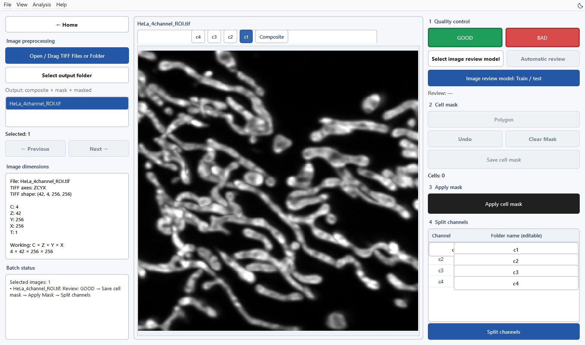
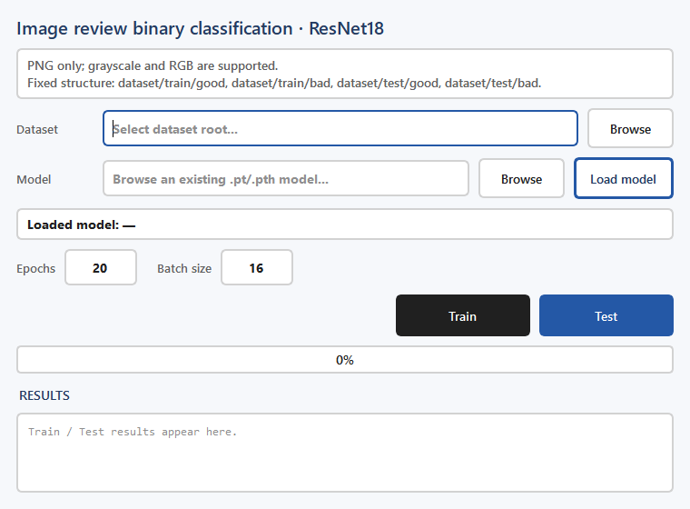

Image preprocessing and quality control
==============================================================================

Inputs and purpose
------------------------------------

Open **Image preprocessing** from Home. Input is a TIFF or folder. Outputs include quality records, Z maximum projections, cell-region masks, and TIFFs separated by cell and channel. Two-dimensional images are handled as Z=1.

   Figure 2. A clear 256×256 HeLa crop retains all four channels and 42 Z slices. Channel c1 is selected to show the mitochondrial grayscale maximum projection. Inputs and dimensions are on the left; image review, cell annotation and channel splitting are on the right.

Procedure
------------------

1. Click **Open / Drag TIFF Files or Folder** and choose Files or Folder in the dialog, or drag a TIFF/folder into the window.
2. Check **IMAGE DIMENSIONS** for TIFF axes, shape, C, Z, Y, and X. Use **Composite** and the channel buttons to switch maximum projections.
3. Click **Select output folder** to set the output root. Without an explicit choice, output locations are organized from the input paths.
4. Inspect focus, signal, and useful image area, then click **GOOD** to enable subsequent cell annotation.
5. Select **Polygon** and draw cell regions on the projection. Use a separate region for each cell. Check Cells on the right and use **Undo** when needed.
6. Click **Save cell mask**, followed by **Apply cell mask**. The same two-dimensional region is applied to every Z slice.
7. Enter channel names in **Folder name (editable)**, then click **Split channels**. Outputs are separated by cell instance and channel.
8. Check outstanding tasks in **BATCH STATUS** and confirm the files in the output folder.

.. important::

   **BAD** moves the source TIFF to ``QC_Bad/`` and handles its existing preprocessing outputs. This changes files on disk. Use demo inputs or input copies while learning the workflow.

Batch operations and shortcuts
------------------------------------------------------------

The left list supports multiple selections. Batch status lists incomplete steps for the selected images. Before batch application, inspect the GOOD status and cell mask of each image. ``G`` marks GOOD, ``B`` marks BAD, and ``Ctrl+Z`` undoes the most recent cell-mask edit.

Train an automatic Image review model
--------------------------------------------------------------------------

   Figure 3. Image-review training and testing configuration.

Click **Image review model: Train / test** and prepare PNG inputs as follows:

.. code-block:: text

   review_dataset/
     train/good/
     train/bad/
     test/good/
     test/bad/

Grayscale and RGB PNGs are supported. Select the dataset root, set Epochs (default 20) and Batch size (default 16), and click **Train**. Load an existing model through Model → Browse → Load model, then click Test. Back in the main interface, use Select image review model and then Automatic review.

Checks and next step
----------------------------------------

Confirm that cell regions align with the original image, channel names are correct, and Z depth is preserved. Two-dimensional cell regions extend along Z; inspect upper and lower slices for neighboring cells within the same projected region. Continue to :doc:`semantic`.
