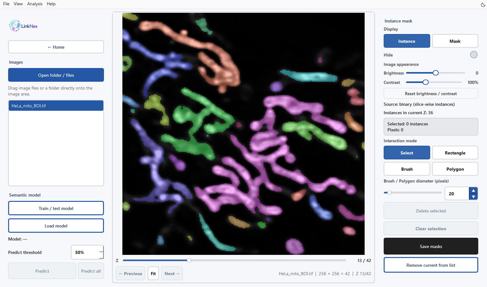
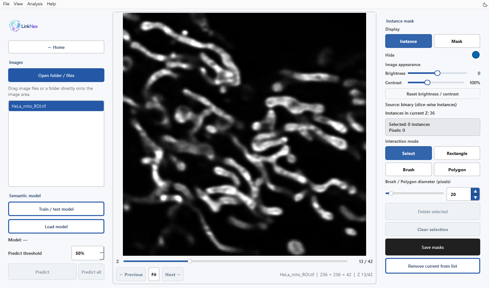
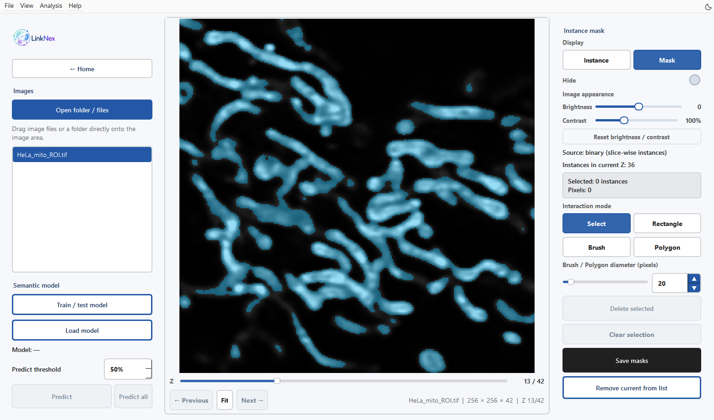
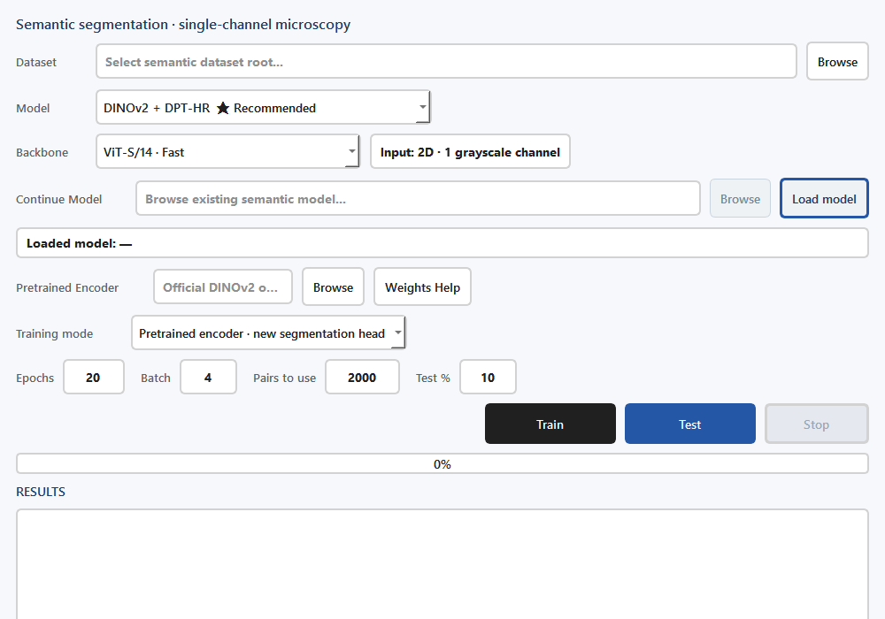

Semantic segmentation, training, and mask revision
====================================================================================================

Inputs and purpose
------------------------------------

Open **Semantic segmentation** from Home. This module trains models on two-dimensional single-channel grayscale images and predicts two-dimensional images or volumetric stacks slice by slice. It also provides mask revision and saving.

   Figure 4. Slice 13/42 of the 256×256 HeLa mitochondrial crop with its supplied mask. Colours distinguish connected foreground regions within this slice.

Load and inspect masks
--------------------------------------------

1. Click **Open folder / files** or drag in images. The application searches for matching binary masks and instance labels in the same directory.
2. Move the **Z** slider to inspect slices. **Instance** displays colored labels, **Mask** displays the binary mask, and **Hide** controls overlay visibility.
3. Adjust **Brightness** and **Contrast** for inspection. These controls affect display without rewriting the source TIFF or mask.
4. Use Select or Rectangle to select labels for deletion. Use Brush or Polygon to add missing foreground; see the controls below.
5. Use **Delete selected** to remove unwanted foreground. **Clear selection** clears the selection state.
6. Click **Save masks**. Saving overwrites the associated mask files; use these updated files downstream.

``Ctrl+S`` saves, ``Delete`` removes selected labels, and left/right arrows switch images. **Remove current from list** removes the image from the loaded list.

   Figure 5. With Hide enabled, inspect the original image at the same slice and zoom. Compare the thin structures and gaps before changing the mask.

   Figure 6. Mask shows foreground in cyan on the same image. Toggle Hide to check boundaries against the original signal. These examples use the supplied mask.

Mask-editing controls
------------------------------------------------------------

.. list-table:: Editing the current Z slice
   :header-rows: 1

   * - Control
     - Operation and result
   * - Select
     - Left-click a label; Ctrl-click toggles additional labels.
   * - Rectangle
     - Drag with the left mouse button to select labels touched by the box. Ctrl adds to the selection.
   * - Brush
     - Left-drag to add a foreground stroke. Each stroke receives a new label; existing foreground is protected. A closed stroke does not fill its interior.
   * - Polygon
     - Hold the left button and draw a continuous outline. Release to close and fill the region. This tool adds foreground on background pixels.
   * - Delete selected
     - Remove the entire selected label regions in the current slice, including parts outside a selection rectangle.
   * - Clear selection
     - Clear selection without changing the mask.
   * - Navigation
     - Right-drag to pan; use the mouse wheel to zoom.

For a false object, select its label and delete it. For a missing thin structure, use Brush; for a missing filled area, use Polygon. Check neighbouring Z slices before saving. Save writes the full binary-mask and instance-label stacks, including edits in other slices.

.. note::

   With a binary mask, Source may show ``binary (slice-wise instances)``. These colored connected regions support slice-wise editing. Module 3 provides full three-dimensional Physical/Social instance analysis.

Predict with an existing model
------------------------------------------------------------

1. Click **Load model** and select a complete LinkODT semantic segmentation checkpoint.
2. Check Model status to confirm successful loading.
3. Set **Predict threshold** (default 50%) and click **Predict** for the current image.
4. Inspect several Z slices, revise clear errors, and save. After confirming one example, use **Predict all** for all loaded images.

**All overwrites existing prediction-mask outputs.** Save a separate copy of manual revisions before batch prediction when those revisions need to be retained.

Training and testing
----------------------------------------

   Figure 7. Current semantic training/test configuration. Architecture, backbone and weight type must match; no training run is implied by this configuration screenshot.

1. Click **Train / test model** and select a Dataset containing ``image/`` and ``mask/``.
2. Select the architecture in **Model** and the encoder backbone in **Backbone**.
3. For initial training, choose **Pretrained encoder · new segmentation head**. The required initialization depends on Model: DINOv2 architectures use a matching encoder; U-Net requires no pretrained encoder; SegFormer-B2 uses its local pretrained model directory.
4. To continue a trained segmentation model, choose **Continue existing LinkODT model** and load the complete model through Continue Model.
5. Set Epochs, Batch, Pairs to use, and Test %, then click **Train**. Inspect pairing checks, split information, and progress in RESULTS.
6. After training, click **Test** to inspect the test table, Dice and other metrics, and image previews. **Stop** requests termination of the current training task.

.. list-table:: Main training settings in the GUI
   :header-rows: 1
   :widths: 24 20 56

   * - Parameter
     - Current default
     - Guidance
   * - Model
     - DINOv2 + DPT-HR
     - DPT decoder with a high-resolution local CNN branch
   * - Backbone
     - ViT-S/14
     - Match the pretrained encoder; ViT-B/14 is a larger option
   * - Epochs
     - 20
     - Inspect convergence using loss curves and previews
   * - Batch
     - 4
     - Reduce batch size first when GPU memory is insufficient
   * - Pairs to use
     - 2000
     - Select from valid pairs; a value above the available count uses all pairs
   * - Test %
     - 10
     - Automatic split fraction; the actual split is saved in a manifest

Model selection
------------------------------

Options include U-Net, DINOv2 + U-Net, DINOv2 + DPT, DINOv2 + DPT-HR, DINOv2 + UPerNet, DINOv2 + QueryMask, and SegFormer-B2. QueryMask uses a portable PyTorch query decoder and is labeled Mask2Former-style. SegFormer-B2 uses the optional transformers dependency.

DINOv2 offers ViT-S/14, ViT-B/14, and their registers variants. Select the Backbone that matches your encoder weights. The GUI default is ViT-S/14.

Training-data and output checks
--------------------------------------------------------------

The application writes ``Semantic_dataset_dimension_check.csv``, ``Semantic_skipped_bad_pairs.csv``, and ``Semantic_split_manifest.csv``. Training previews predict a fixed test subset each epoch. If those previews guide model selection, reserve an additional independent final test set and group adjacent slices by original sample or experimental batch.

Complete models are saved as timestamped files under the project's ``models/`` folder. Curves and ``Semantic_training_metrics.csv`` record training. Test outputs include ``Semantic_test_results.csv``. Use the paths printed in RESULTS to locate the files.

After saving the masks, continue to :doc:`instance`.

Choosing the correct weights
------------------------------------------------------------

.. list-table:: Weight files and their uses
   :header-rows: 1

   * - Task / architecture
     - Required input
   * - Predict
     - A complete LinkODT segmentation checkpoint, including the segmentation head.
   * - New DINOv2 training
     - Official DINOv2 or project SSL encoder weights matching Backbone.
   * - New U-Net training
     - No pretrained encoder; the encoder-weight controls are disabled.
   * - New SegFormer-B2 training
     - Optional transformers dependencies and local ``models/hf_segformer_b2_ade`` files.
   * - Continue existing LinkODT model
     - A complete LinkODT checkpoint. Architecture and backbone are restored from the checkpoint.

Encoder initialization files alone cannot be used for Predict. At the default 50% prediction threshold, pixels above the probability cutoff become foreground. Lowering the threshold includes more foreground; raising it includes less. Inspect boundaries, small objects, and multiple Z slices when selecting a threshold.

Saving and leaving an image
------------------------------------------------------------

When changing images or closing the application with unsaved mask edits, choose **Save**, **Discard**, or **Cancel**. Save writes your edits before continuing; Cancel keeps the current image open. If saving fails, the application keeps the unsaved state.
