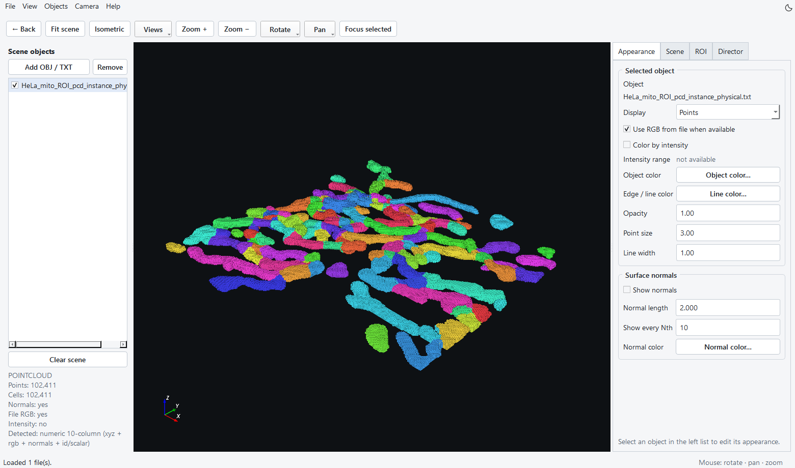
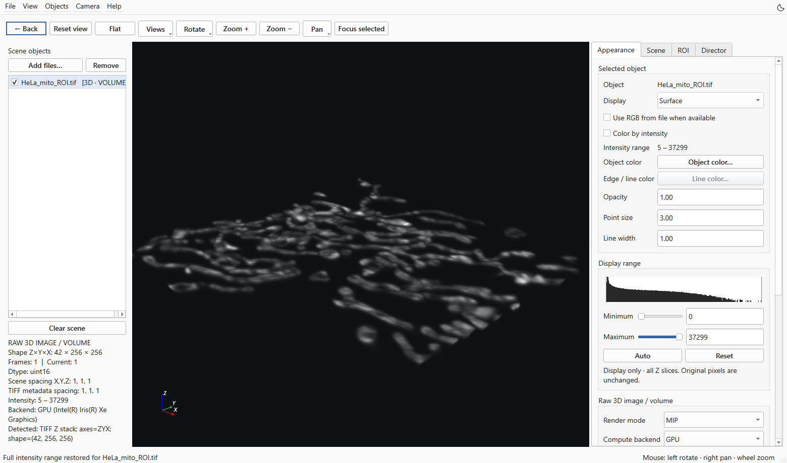
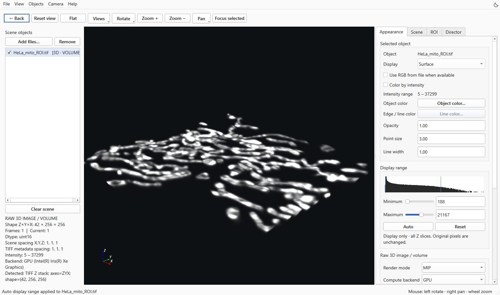
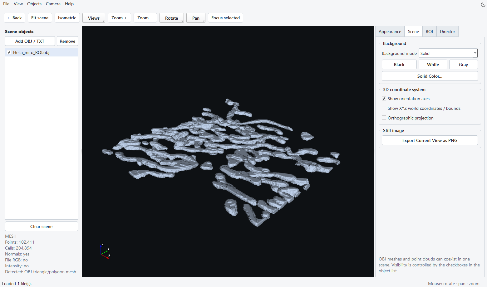
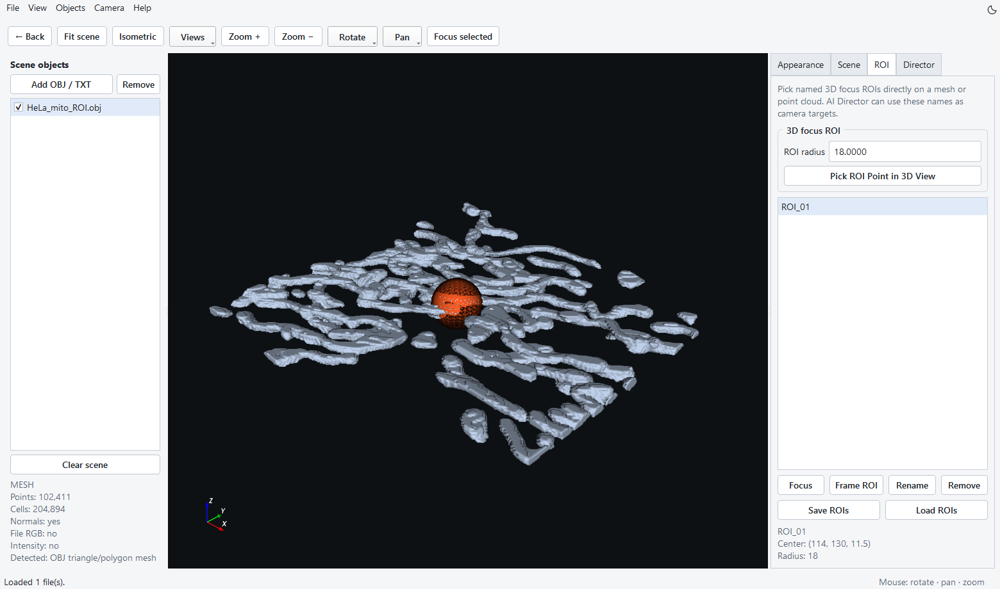
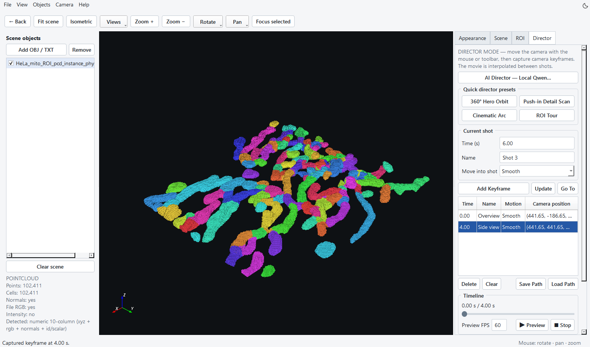

Visualization Studio
========================================

To return to the main application, click **← Back** at the left of the toolbar, press ``Ctrl+W``, or close the Visualization Studio window. The main application remains open because the viewer runs separately. Use ``Alt+Tab`` to select LinkODT if another window is in front. Export any images and camera paths you want to retain before closing.

Starting and loading data
--------------------------------------------------

Click **Visualization** on Home to open the independent application. Alternatively, run from the project root:

.. code-block:: powershell

   python visualization/main.py

Inputs include TIFF images, three-dimensional TIFF stacks, TIFF time series, OBJ meshes, and TXT/CSV point clouds. TIFF channels are loaded as separate scene objects. Header-based point-cloud tables should identify ``x,y,z``. Optional columns include ``r,g,b``, ``nx,ny,nz``, intensity, and labels. Column layouts are inferred for files without headers; inspect colors and normals after loading.

Menus and interface themes
----------------------------------------------------------------------

Use **File** to open objects, export images/movies, and load or save camera paths. **View** contains fit/view options, panel visibility, and theme settings. **Objects** manages the scene list. **Camera** contains rotation, panning, focus, and keyframe commands. **Help** opens the guide and team information.

The compact toolbar keeps Reset view, Flat, Zoom and Focus selected visible. **Views**, **Rotate**, and **Pan** open menus for less frequent operations. Use **View → Fit scene** to fit all visible objects. The controls on the right can be scrolled when the window is short.

Click the top-right sun/moon button, use **View → Theme**, or press ``Ctrl+Shift+T``. The preference is saved and shared by the main application and Visualization Studio. Interface themes leave object colours, scene background and exported-image colours unchanged; change the rendering background in Scene.

   Figure 15. Physical-instance point cloud calculated from the real HeLa crop, displayed using file RGB colours. The current viewer includes the Back button, grouped camera menus and theme switch.

Objects and appearance
--------------------------------------------

1. Click **Add files…** or drag in files. Several objects can be loaded together.
2. Use Scene objects checkboxes to control visibility. Select an object before changing its properties.
3. Choose Surface, Surface + Edges, Wireframe, or Points and set Point size, Line width, and Opacity.
4. Use file RGB to display instance colors, or choose a uniform color with Object color….
5. For XYZ + Intensity point clouds, intensity modulates color brightness with a current floor of 0.35. Inspect Intensity range and distinguish display colors from the original intensity units.
6. Display normals, coordinate axes, and the world grid as needed.

TIFF brightness and contrast
--------------------------------------------

Select a TIFF channel in **Scene objects**, then open **Appearance → Display range**. These controls work with both **MIP** and **Volume** rendering. The histogram shows the channel's intensity distribution, using logarithmic bar heights to keep sparse intensities visible; blue markers indicate the current display limits.

* **Auto** selects a display range from the intensity distribution. LinkODT uses the 0.175th and 99.825th percentiles, estimated from at most one million evenly spaced values, so a small fraction of extreme values falls outside the range. Repeated clicks give the same range for the same data.
* **Reset** restores the full finite intensity range. It also sets Brightness to 0, Contrast to 1, and Background cutoff to 0. Object colour, opacity, camera, calibration, and rendering mode stay as selected.
* **Minimum / Maximum** can be adjusted with sliders or entered as raw intensity values. Values at or below Minimum appear dark; values at or above Maximum appear at the brightest end of the selected colour. A narrower range increases visible contrast. Editing either limit resets relative brightness, contrast, and background cutoff so the entered range is used directly.

Click **Reset** to view the full range, then **Auto** to inspect dim structures. Refine Minimum or Maximum if needed. The existing **Brightness**, **Contrast**, and **Background cutoff** controls remain available; the displayed limits follow brightness and contrast changes.

Each channel keeps its own settings. For a time series, Auto and Reset use all time points of that channel, and the window stays fixed during playback. Constant-valued data use a small positive display width; non-finite values are excluded from the estimate.

These controls change the display mapping only. They do not alter TIFF pixels, create binary masks, or affect segmentation and measurements. PNG images and movies record the displayed appearance. Use the segmentation modules to generate or edit masks.

   Reset: the full intensity range of the real HeLa mitochondrial crop. The histogram and display limits are in Appearance; the original image remains unchanged.

   Auto: the same data, camera, colour and rendering mode, with an automatically selected display window. Compare this view with Reset to inspect the effect on dim structures.

Scene settings and PNG
--------------------------------------------

In Scene, choose a solid or gradient background using Black, White, Gray, or custom colors. Use Fit scene, Isometric, and the Views dropdown to establish a view, then choose perspective or orthographic projection. Click **Export Current View as PNG** to save the current scene.

   Figure 16. The OBJ surface from the same HeLa crop shows the foreground geometry. Scene contains background, projection, coordinate-axis and PNG-export controls. A mesh displays the surface; the coloured TXT view displays instance labels.

Three-dimensional ROIs and focus
----------------------------------------------------------------

In ROI, set a name and radius. Click **Pick ROI Point in 3D View**, then select a point on an object. Use Focus / Frame ROI to center the camera on the target. ROIs can be saved as JSON and reloaded. These ROIs organize focus and camera shots; quantitative time-series ROIs are set in module 5.

   Figure 17. ROI_01 is centred on a point of the surface, with radius 18 in voxel coordinates. Select the named ROI to use Focus or Frame ROI. The wire sphere guides camera framing and does not change the segmentation or measurements.

Director camera animation
--------------------------------------------------

   Figure 18. Two camera keyframes at 0 s and 4 s around the HeLa point cloud. Director supports preview, path saving and MP4 export; no video export was performed for this screenshot.

1. Establish the starting camera view using the mouse or toolbar.
2. Set Time to 0 s and click **Add Keyframe**.
3. Move to the next view, enter a later time, and add another keyframe.
4. Choose the transition into that shot, such as Smooth, Orbit, Linear, or Hold.
5. Click Preview, inspect the full timeline, and adjust keyframes as needed.
6. Save the camera path as JSON, set output FPS and Resolution scale (1×–4×), and export MP4.

360° Hero Orbit, Push-in Detail Scan, Cinematic Arc, and ROI Tour provide quick presets. Split large rotations into intermediate keyframes. Orbit currently uses constant angular velocity. ROI helper spheres are hidden during preview and video export.

AI Director (optional)
--------------------------------------------

After installing local inference dependencies and preparing a GGUF model, open AI Director, select the local model, and describe the camera sequence, for example: “Orbit the entire scene once, then move closer to ROI_1.” Inspect the generated action plan before applying it to the timeline and previewing it. The model generates a constrained camera-action plan. Manual keyframes work independently.

